# Istana Block Purwakarta — situs web dan aplikasi internal (situs, operasional, keuangan)

Situs web Istana Block Purwakarta yang dibangun ulang dengan **Next.js 15** dan berjalan di **Cloudflare Workers**. Data disimpan di **Cloudflare D1** dan gambar di **Cloudflare R2**. Pintu masuk staf ada di **`/internal`**: pilih aplikasi **Situs** (`/situs`, produk, harga, artikel, halaman), **Operasional** (`/operasional`, pesanan, pengiriman, stok, lacak truk), atau **Keuangan** (`/akuntansi`, pembukuan ala Zahir dan laporan). Situs & Keuangan masuk dengan email + password; gudang, sopir, dan staf lapangan masuk ke Operasional dengan nomor HP + PIN 6 angka.

**Status & dokumentasi:** [docs/STATUS.md](docs/STATUS.md), [docs/README.md](docs/README.md)


## Tampilan

| Beranda (desktop) | Halaman produk (U-Ditch) |
|---|---|
|  |  |

| Kalkulator pola & warna | Galeri | Paket proyek |
|---|---|---|
|  |  |  |

| Area pengiriman | Halaman area (CMS) | Produk + lembar spesifikasi |
|---|---|---|
|  |  |  |

| Ponsel — beranda | Ponsel — menu | Ponsel — kalkulator pola | Ponsel — produk |
|---|---|---|---|
|  |  |  |  |

Artikel: [docs/screenshots/artikel.webp](docs/screenshots/artikel.webp)

**Aplikasi Situs (`/situs`)**

| Login | Ringkasan | Daftar produk | Halaman |
|---|---|---|---|
|  |  |  |  |

| Ubah produk | Tabel harga | Info & kontak |
|---|---|---|
|  |  |  |

**Editor isi & komponen form** (dipakai di Situs, Operasional, dan Keuangan)

| Editor artikel (visual) | Tautan ke halaman situs |
|---|---|
| 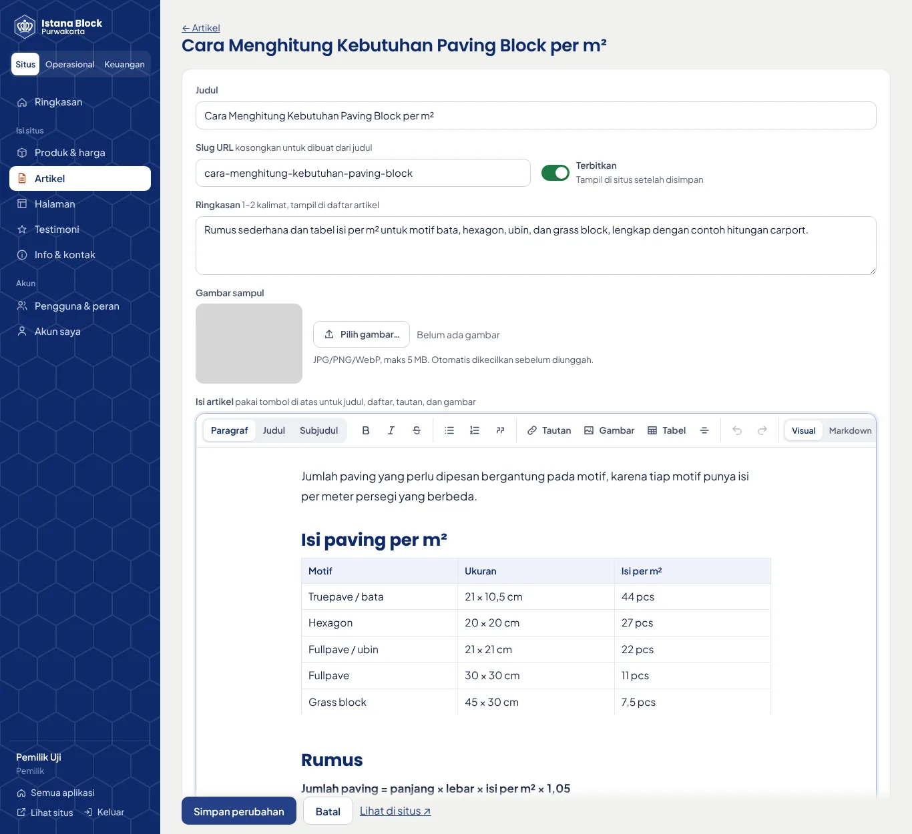 | 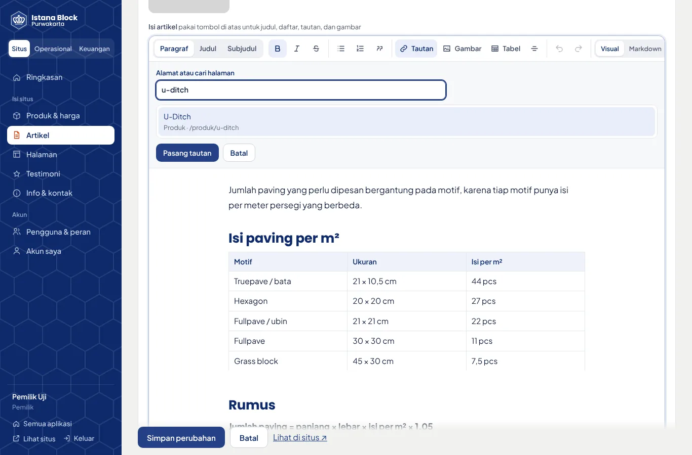 |

| Pilihan dengan pencarian | Kalender | Ponsel — pilihan | Ponsel — kalender |
|---|---|---|---|
| 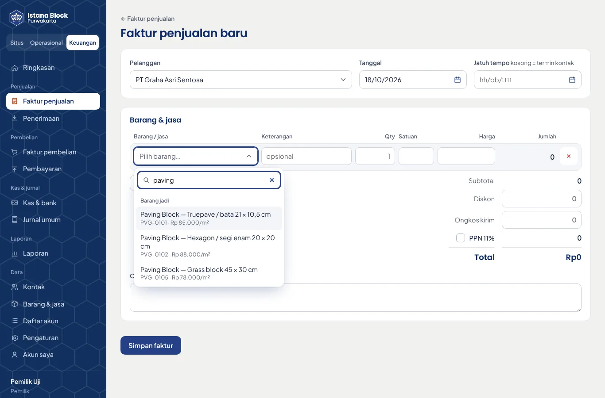 | 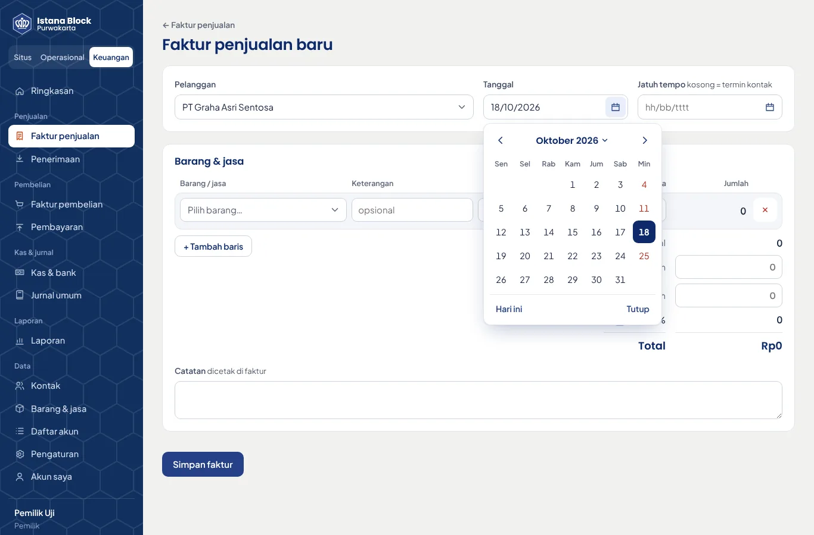 | 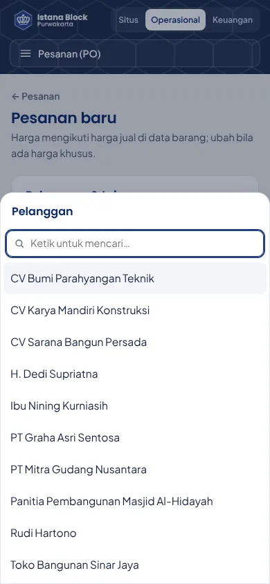 | 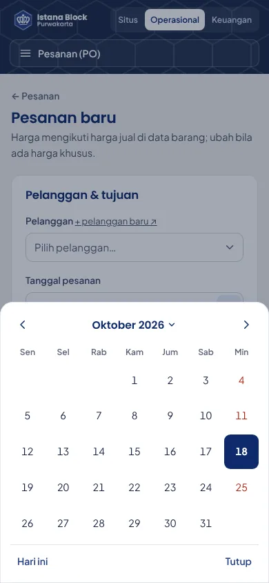 |

**Video fitur di beranda** (16:9 di desktop, 9:16 di ponsel)

| Desktop | Ponsel |
|---|---|
|  |  |

Katalog lengkap: [docs/screenshots/katalog.webp](docs/screenshots/katalog.webp)

**Keuangan & operasional**

| Ringkasan keuangan | Faktur penjualan | Cetak faktur |
|---|---|---|
|  |  |  |

| Laba rugi | Neraca | Ringkasan operasional |
|---|---|---|
|  |  |  |

| Pesanan (PO) | Surat jalan | Cetak surat jalan | Ponsel — surat jalan (gudang) |
|---|---|---|---|
|  |  |  |  |

| Ringkasan gudang | Pengguna & peran |
|---|---|
| 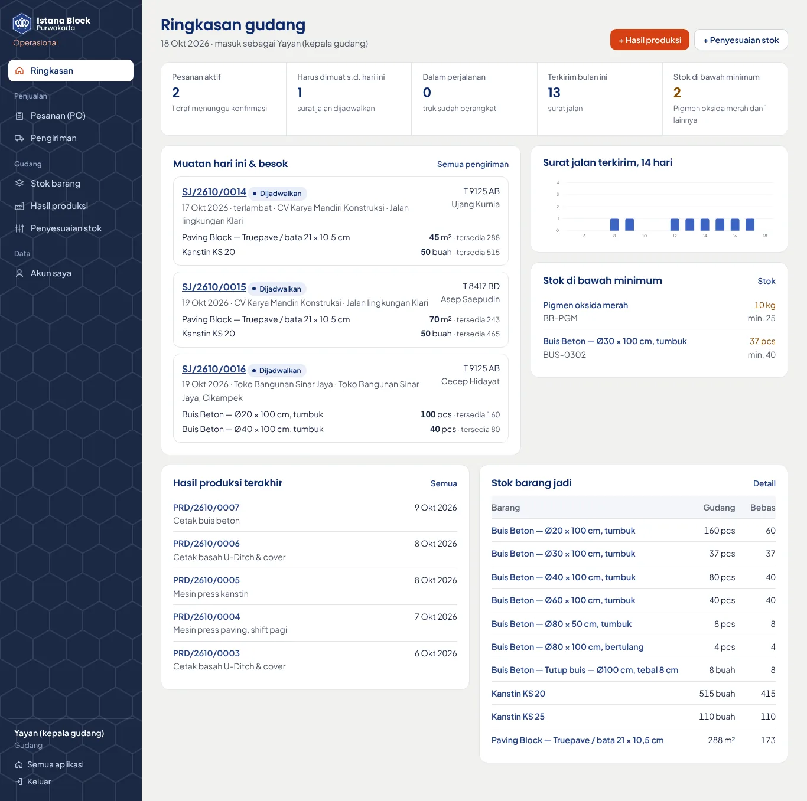 | 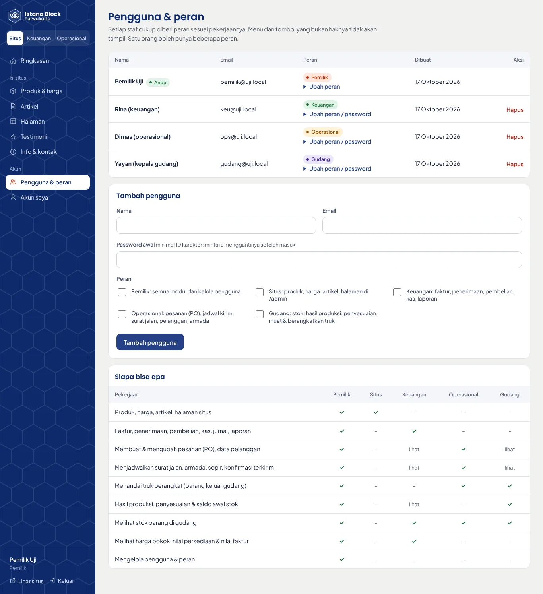 |

**Portal, login lapangan, lacak truk, tugas sopir, laporan**

| Pilih aplikasi (`/internal`) | Masuk Operasional (HP & PIN) | Lacak truk |
|---|---|---|
| 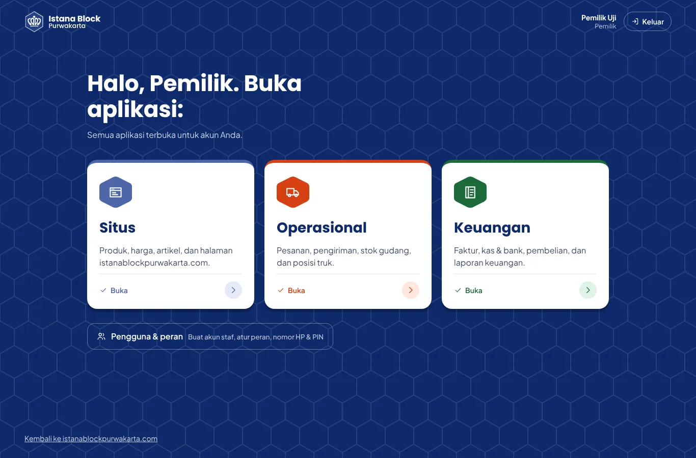 | 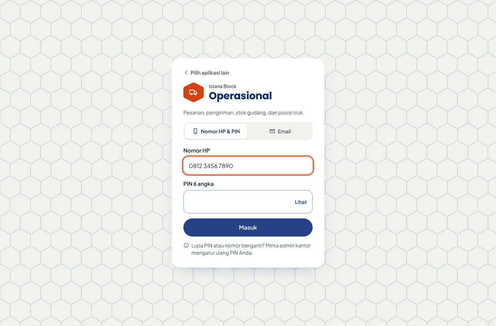 | 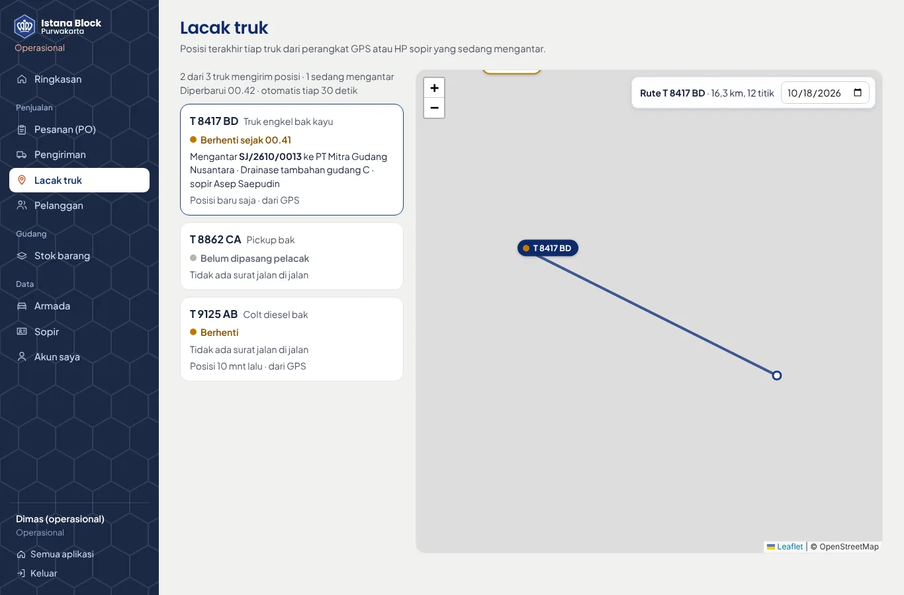 |

| Ponsel — tugas sopir | Ponsel — surat jalan sopir | Hub laporan | Arus kas | Umur piutang |
|---|---|---|---|---|
| 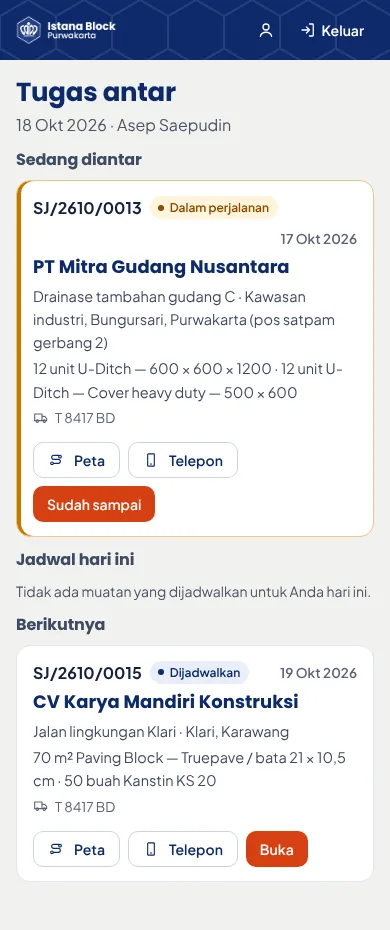 | 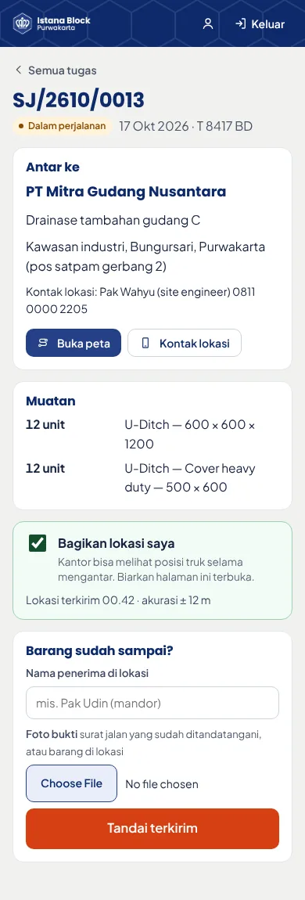 | 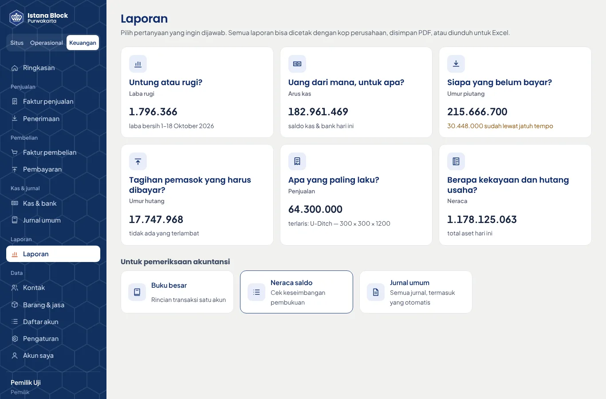 | 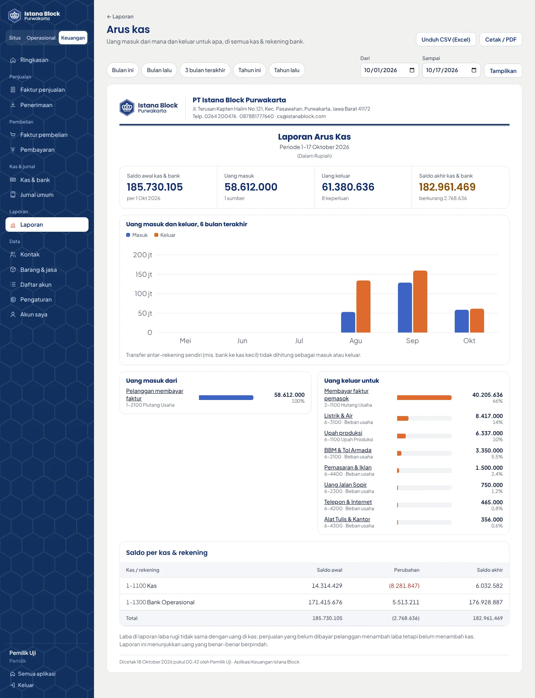 | 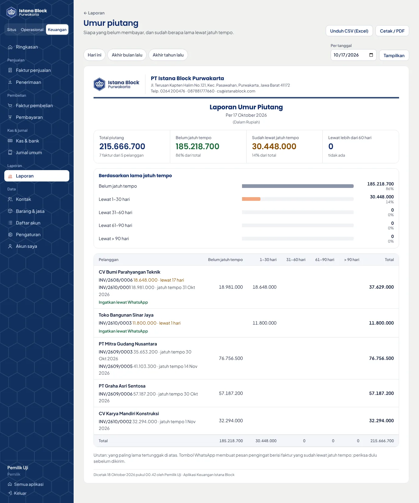 |

Contoh hasil cetak berkop dari data contoh: [semua dokumen & laporan dalam satu PDF](docs/contoh-cetak/contoh-cetakan.pdf) (faktur, surat jalan, laba rugi, neraca, arus kas, penjualan, umur piutang & hutang, neraca saldo, buku besar, beserta daftar angka yang saling cocok), atau satu per satu: [faktur](docs/contoh-cetak/faktur.pdf), [surat jalan](docs/contoh-cetak/surat-jalan.pdf), [laba rugi](docs/contoh-cetak/laba-rugi.pdf), [neraca](docs/contoh-cetak/neraca.pdf).

Data di gambar adalah **data contoh fiktif** (lihat [Data contoh](#data-contoh-untuk-latihan)), bukan transaksi sungguhan. Peta lacak truk di gambar memakai titik uji; latar peta OpenStreetMap tidak termuat di lingkungan uji.

## Fitur

**Situs publik**
- Beranda: hero dengan foto pabrik, keunggulan, logo klien proyek, video fitur, kartu produk dari database, kalkulator cepat (hasil langsung dikirim ke WhatsApp admin) dengan tautan ke kalkulator pola, blok kontraktor + TKDN, paket jasa pasang, cuplikan galeri, FAQ (diisi dari admin), testimoni, artikel terbaru.
- `/pola-paving`: **kalkulator pola & warna**. Pilih jenis paving (5 jenis, 23 motif), warna dasar dan aksen, lalu lihat pratinjau tampak atas berskala asli. Menghitung pcs per warna dari pola berulang (bisa diubah manual per %), cadangan 0/3/5/10%, kanstin 40/60 cm, abu batu alas 5 cm, dan base course 20 cm. Rincian bisa dikirim ke WhatsApp, disalin, atau dicetak; semua pilihan tersimpan di URL sehingga bisa dibagikan.
- `/produk`, `/produk/[slug]`: spesifikasi, tabel harga per grup (misalnya U-Ditch dan Cover heavy duty), lembar spesifikasi & TKDN asli, deskripsi, cara memesan, FAQ, produk terkait. Tombol WhatsApp memakai pesan khusus per produk.
- `/paket-proyek`: paket material untuk kontraktor: alur pemesanan, tabel harga acuan semua produk + TKDN, syarat, logo klien, FAQ.
- `/area-pengiriman`: wilayah kirim beserta jarak dari pabrik, ketentuan Jabodetabek, cara ongkir dihitung, dan tombol cek ongkir. Kartu wilayah otomatis menautkan ke halaman area yang sudah terbit.
- `/galeri`: 24 foto pemasangan dan stok pabrik dengan filter, ukuran asli dibuka saat diklik.
- Halaman dari admin di `/slug`: halaman area (Karawang & Cikampek, Subang, Bekasi & Cikarang) dan halaman informasi (`/profil`, `/sertifikat-tkdn`, `/privacy-policy`).
- `/artikel`, `/artikel/[slug]`: artikel berformat Markdown.
- `/kontak`: alamat, jam buka, telepon kantor, tombol WhatsApp/telepon, dan peta Google Maps bila URL embed diisi di admin.
- **Video fitur** di beranda: rekaman UI asli (kalkulator paving → kirim ke WhatsApp → tabel harga U-Ditch) yang berputar senyap seperti GIF. Desktop, laptop, dan tablet mendatar memakai versi 16:9; ponsel dan tablet yang dipegang tegak memakai 9:16. Format dipilih otomatis dan langsung berganti saat layar diputar atau jendela browser diubah ukurannya (video dan posternya sama-sama ikut). Tombol "Putar dengan suara" memutar versi voice-over 28 detik dengan subtitle. Video baru dimuat saat terlihat, dijeda saat keluar layar, dan tidak autoplay bila pengunjung memilih "kurangi gerakan".
- Desain mengikuti brand: logo resmi dari situs lama, biru logo `#254186`, oranye `#FE5722`, abu beton, motif paving segi enam, huruf Poppins + Plus Jakarta Sans (di-host sendiri, tanpa Google Fonts).
- Menu ringkas di ponsel, bar kontak melayang; tanpa scroll horizontal di layar 390 px.

**SEO**
- Halaman dirender di server (HTML lengkap untuk Google), `<title>`, meta description, canonical, dan Open Graph per halaman. Semua bisa diubah dari admin.
- Data terstruktur JSON-LD: `HomeAndConstructionBusiness` (alamat, telepon kantor; tanpa `aggregateRating` karena rating milik sendiri tidak ditampilkan Google), `Product` + `AggregateOffer` (rentang harga IDR), `BreadcrumbList`, `FAQPage`, `Article`, `WebPage`.
- `sitemap.xml` dan `robots.txt` otomatis dari database; `/internal`, `/situs`, `/akuntansi`, dan `/operasional` diberi `noindex`.
- Redirect 301 dari alamat WordPress lama (`/paving-block/`, `/u-ditch-istana-block-purwakarta/`, `/servis/`, dan lainnya) ke halaman baru dalam **satu kali** pengalihan, termasuk membuang `/` di akhir URL; alamat yang sengaja dihapus mendapat **410 Gone**. Ditangani `src/middleware.ts`, daftarnya ada di `src/data/legacy-redirects.json` (`{ "/lama": "/baru" }` atau `"410"`).

**Pintu masuk (`/internal`) & login**
- `/internal` menampilkan tiga kartu: Situs, Operasional, Keuangan. Setelah dipilih, staf diarahkan ke halaman masuk aplikasi itu (`/situs/masuk`, `/operasional/masuk`, `/akuntansi/masuk`). Yang sudah login langsung masuk; kartu aplikasi yang bukan haknya tampil terkunci.
- **Email + password** untuk Situs dan Keuangan, juga untuk pemilik/admin di Operasional. **Nomor HP + PIN 6 angka** untuk staf lapangan (gudang, sopir, operasional lapangan); sesi PIN hanya bisa membuka Operasional.
- Sesi cookie `httpOnly` 7 hari. Lima kali salah untuk satu email/nomor HP (atau sepuluh kali dari satu alamat IP) dikunci 15 menit. PIN yang terlalu mudah (angka sama semua, berurutan, pola berulang) ditolak.
- Alamat lama tetap jalan: `/admin` → `/internal`, `/admin/…` → `/situs/…`, `/keuangan/…` → `/akuntansi/…` (301).

**Aplikasi Situs (`/situs`)**
- **Produk & harga:** tambah, ubah, hapus; foto diunggah ke R2 (otomatis dikecilkan ke WebP ≤ 1600 px di browser); spesifikasi, tabel harga, dan FAQ bisa ditambah atau dihapus per baris; deskripsi lengkap memakai editor visual; status tayang/draf dan tampil di beranda; urutan; SEO.
- **Artikel:** editor visual seperti di WordPress (lihat [Editor isi](#editor-isi)), gambar sampul, terbit/draf, SEO.
- **Halaman:** halaman statis di `/slug`, jenis *Area pengiriman* (tombol WhatsApp menanyakan ongkir ke lokasi itu) atau *Informasi*; editor visual, sampul, terbit/draf, SEO. Slug yang dipakai sistem (`produk`, `artikel`, `internal`, `situs`, `akuntansi`, …) atau oleh peta redirect lama ditolak.
- **Testimoni:** nama, keterangan, kutipan, rating, urutan. Bagian ulasan di beranda baru muncul kalau sudah ada testimoni.
- **Info & kontak:** WhatsApp, telepon, telepon kantor, email, alamat, jam buka, link & peta embed Google Maps, rating Google, teks beranda, FAQ beranda (diisi per baris: pertanyaan dan jawaban), syarat pembayaran, kota tujuan kirim, tautan katalog, info TKDN, SEO beranda.
- **Pengguna & peran** (khusus pemilik, `/internal/pengguna`): buat akun kantor (email) atau akun lapangan (nomor HP + PIN), atur peran, hubungkan akun sopir ke data sopir, atur ulang password/PIN. **Akun saya:** ganti nama dan password (atau PIN untuk akun lapangan); setelah diganti, sesi di perangkat lain otomatis keluar.

### Editor isi

Isi artikel, isi halaman, dan deskripsi produk ditulis dengan editor visual: yang tampil saat menulis sama dengan yang tampil di situs (huruf, ukuran judul, tabel, gambar).

- **Bilah alat:** Paragraf / Judul / Subjudul, tebal, miring, coret, daftar berpoin & bernomor, kutipan, tautan, gambar, tabel, garis pemisah, urungkan/ulangi. Bilah alat menempel di atas saat menggulir isi yang panjang.
- **Tautan:** ketik nama produk, artikel, atau halaman untuk memilih dari daftar (alamatnya terisi otomatis), atau tempel alamat luar. `istanablock.com` otomatis jadi `https://…`, nomor telepon jadi `tel:`, email jadi `mailto:`; alamat `javascript:` ditolak.
- **Gambar:** pilih dari komputer/HP, tempel (Ctrl+V), atau seret ke dalam isi. Foto dikecilkan dulu di browser (WebP ≤ 1600 px), diunggah ke R2, lalu disisipkan. Klik gambar untuk mengisi keterangannya (teks alt untuk Google dan pembaca layar) atau menghapusnya.
- **Tabel:** sisipkan tabel 3 × 3 berjudul kolom; saat kursor di dalam tabel muncul tombol tambah/hapus baris dan kolom.
- **Ketik cepat:** `## ` jadi judul, `- ` jadi daftar, `1. ` jadi daftar bernomor, `> ` jadi kutipan, Ctrl+B/I/K.
- **Mode Markdown** tetap ada untuk yang terbiasa; berpindah mode tidak mengubah isi.
- **Draf otomatis:** ketikan disimpan di browser perangkat itu. Bila halaman tertutup sebelum disimpan, saat dibuka lagi muncul pilihan *Pulihkan* atau *Buang*.
- Isi tetap disimpan sebagai **Markdown** di database, jadi tampilan situs dan data lama tidak berubah. Membuka lalu menyimpan tanpa mengedit tidak mengubah teks yang tersimpan.

### Komponen form

Semua aplikasi memakai komponen form yang sama dengan warna Istana Block (`src/components/ui`), bukan tampilan bawaan browser:

- **`Select`**: daftar pilihan dengan kotak cari untuk daftar panjang (pelanggan, barang, akun), pengelompokan (mis. *Barang jadi*, *Bahan baku*, golongan akun), keterangan kecil di bawah pilihan (kode barang, harga, stok), dan navigasi keyboard. Di ponsel tampil sebagai lembar dari bawah layar.
- **`DateField`**: tanggal ditulis `17/10/2026` (juga menerima `17-10-26`, `17 okt 2026`, `2026-10-17`) atau dipilih dari kalender: Senin di depan, nama bulan Indonesia, Minggu merah, hari ini bertanda oranye, tombol *Hari ini*.
- **`Switch`**: sakelar untuk *Terbitkan*, *Tampilkan di situs*, *Tampilkan di beranda*. Kotak centang dan pilihan file (gambar sampul, foto bukti terima) juga diseragamkan.

Nilai dikirim lewat input bernama seperti `<select>`/`<input type="date">` sebelumnya (tanggal tetap `YYYY-MM-DD`), jadi server action dan form filter (GET) tidak berubah. Validasi *wajib diisi* bawaan browser tetap jalan.

```tsx
import { DateField, Select, Switch } from "@/components/ui";

<Select id="po-contact" name="contactId" required searchable placeholder="Pilih pelanggan…"
  options={contacts.map((c) => ({ value: c.id, label: c.name, hint: c.company }))} />
<DateField id="po-date" name="date" defaultValue={today} required />
<Switch name="published" defaultChecked label="Terbitkan" />
```

## Operasional (`/operasional`) & keuangan (`/akuntansi`)

Satu alur dari pesanan sampai pembukuan:

```
Pesanan (PO) ─► Surat jalan ─► truk berangkat ─► terkirim + foto bukti ─► Faktur ─► Penerimaan
   operasional      operasional     stok keluar & HPP otomatis            keuangan    piutang lunas
```

**Peran pengguna.** Diatur pemilik di `/internal/pengguna` (di sana juga ada tabel *Siapa bisa apa* dan tombol reset password staf). Satu orang boleh punya beberapa peran; setelah login ia langsung masuk ke modulnya. Menu dan tombol yang bukan haknya tidak tampil, dan setiap server action memeriksa ulang haknya.

| Pekerjaan | Pemilik | Situs | Keuangan | Operasional | Gudang | Sopir |
|---|:-:|:-:|:-:|:-:|:-:|:-:|
| Cara masuk | email | email | email | email / HP | HP & PIN | HP & PIN |
| Produk, harga, artikel, halaman situs | ✓ | ✓ | | | | |
| Faktur, penerimaan, pembelian, kas, jurnal, laporan keuangan | ✓ | | ✓ | | | |
| Membuat & mengubah pesanan (PO), data pelanggan | ✓ | | lihat | ✓ | lihat | |
| Menjadwalkan surat jalan, armada, sopir, konfirmasi terkirim | ✓ | | lihat | ✓ | lihat | |
| Menandai truk berangkat (barang keluar gudang) | ✓ | | | ✓ | ✓ | |
| Hasil produksi, penyesuaian & saldo awal stok | ✓ | | lihat | | ✓ | |
| Melihat stok barang di gudang | ✓ | | ✓ | ✓ | ✓ | |
| Melihat posisi truk di peta | ✓ | | | ✓ | | |
| Tugas antar sendiri: berangkat, terkirim + foto, bagikan lokasi | | | | | | ✓ |
| Melihat harga pokok, nilai persediaan & nilai faktur | ✓ | | ✓ | | | |
| Mengelola pengguna & peran | ✓ | | | | | |

Contoh pembagian: admin penjualan = *Operasional* (email); kepala gudang = *Gudang* (HP & PIN); sopir = *Sopir* (HP & PIN, dihubungkan ke data sopirnya); staf akuntansi = *Keuangan*. Akun lama otomatis berperan *pemilik*.

> **Sudah punya akun berperan Operasional?** Mulai versi ini, peran *Operasional* tidak lagi mencatat hasil produksi dan penyesuaian stok; pekerjaan itu pindah ke peran baru *Gudang*. Bila orang yang sama masih mengurus stok, centang juga *Gudang* di `/internal/pengguna`.

**Operasional** (meniru aplikasi PO & pengiriman yang dipakai sekarang)
- **Pesanan (PO):** pelanggan, nomor PO pelanggan, proyek, alamat & kontak lokasi, tautan Google Maps, tanggal minta kirim, barang & harga (otomatis dari harga jual), ongkir, diskon, PPN. Bisa disimpan sebagai draf. Status berjalan sendiri: *dikonfirmasi → dikirim sebagian → terkirim*, lalu bisa ditandai *selesai* atau *batal*. Halaman pesanan memperlihatkan per barang berapa yang dipesan, dijadwalkan, dikirim, diterima, dan sudah difaktur.
- **Pengiriman (surat jalan):** dijadwalkan dari sisa pesanan (tidak bisa melebihi qty pesanan), pilih armada & sopir. Tombol *Truk berangkat* dan *Tandai terkirim* (nama penerima + foto bukti dari kamera ponsel). Surat jalan bisa dicetak (A4, tanda tangan pengirim–sopir–penerima). Foto bukti disimpan di R2 dan hanya bisa dibuka pengguna yang login.
- **Stok:** stok per barang, yang sudah dijadwalkan kirim, stok bebas, kartu stok. **Hasil produksi** (barang jadi masuk, bahan baku keluar) dan **penyesuaian stok** (stok opname, rusak, atau saldo awal). Peran *Gudang* mencatat jumlahnya saja; nilai rupiah dihitung sistem dan hanya terlihat oleh keuangan & pemilik.
- **Pelanggan, armada, sopir.** Data pelanggan sama dengan kontak di modul keuangan. Armada punya kolom *ID perangkat GPS*.
- **Lacak truk** (`/operasional/lacak`): peta posisi terakhir tiap truk (bergerak, berhenti sejak jam berapa, atau tanpa sinyal), surat jalan yang sedang diantar beserta jarak lurus ke tujuan (bila pesanan punya tautan Google Maps berkoordinat), dan rute per tanggal. Diperbarui otomatis tiap 30 detik. Peta memakai OpenStreetMap.
- **Tugas sopir** (`/operasional/tugas`, tampilan ponsel): surat jalan milik sopir hari ini dan berikutnya, tombol buka peta & telepon kontak lokasi, *Barang sudah dimuat, saya berangkat*, lalu *Tandai terkirim* dengan nama penerima dan foto bukti (foto dikecilkan di HP sebelum diunggah). Sopir hanya melihat surat jalannya sendiri.
- **Ringkasan menyesuaikan peran.** Operasional melihat pesanan yang belum dijadwalkan dan muatan hari ini; gudang melihat *Ringkasan gudang*: muatan hari ini & besok dengan stok yang tersedia, stok di bawah minimum, hasil produksi terakhir, dan stok barang jadi.

**Menyambungkan GPS truk.** Pemilik membuat kunci di **Lacak truk → Pengaturan GPS**, lalu memakai alamat penerima `https://<domain>/api/lacak/gps?key=<kunci>` (atau `/api/lacak/gps/<kunci>`). Yang bisa mengirim ke alamat itu:
- alat GPS, gateway, atau server pelacak (mis. Traccar) yang bisa meneruskan posisi lewat HTTP berformat **OsmAnd** (`id`, `lat`, `lon`, `timestamp`, `speed` dalam knot, `bearing`);
- aplikasi gratis **Traccar Client** di HP sopir (tetap jalan di latar belakang): isi *Server URL* dengan alamat di atas dan *Device identifier* dengan ID perangkat truk;
- sistem lain lewat JSON: `{ "id", "lat", "lng", "speed_kmh", "heading", "time" }` (satu objek atau daftar).

`id` harus sama dengan *ID perangkat GPS* di data armada. Bila vendor GPS hanya punya aplikasi/web sendiri tanpa fitur meneruskan data, perlu akses **API vendor** dan sedikit kode penyesuaian. Tanpa alat apa pun, sopir bisa menekan **Bagikan lokasi** di halaman tugas (hanya selama halaman terbuka dan surat jalan sedang diantar). Riwayat posisi disimpan 120 hari.

**Saling terhubung.** Data dari satu bagian langsung dipakai bagian lain, tanpa ketik ulang:
- Saat membuat pesanan atau menjadwalkan kirim, kolom **stok bebas** (stok gudang dikurangi yang sudah dijadwalkan) tampil per barang, dan muncul peringatan bila pelanggan itu **punya faktur lewat jatuh tempo** (tanpa memperlihatkan nominalnya ke operasional).
- **Muatan hari ini & besok** dihitung berurutan dari stok gudang; muatan yang stoknya kurang ditandai supaya gudang mencatat produksi dulu atau jadwalnya digeser.
- Surat jalan yang sudah terkirim tapi belum difaktur muncul di ringkasan keuangan sebagai **Siap difaktur**, lengkap dengan tombol *Buat faktur* yang barisnya terisi otomatis.
- Barang jadi keluar (truk berangkat) langsung membuat jurnal HPP; bahan baku di bawah stok minimum muncul di ringkasan keuangan sebagai **Bahan baku perlu dibeli**.

**Keuangan** (konsep Zahir: semua transaksi menjadi jurnal berpasangan)
- **Penjualan:** faktur penjualan (bisa dibuat dari pesanan; barisnya terisi dari barang yang sudah diterima pelanggan dan belum difaktur), PPN 11% (bisa diubah), ongkir, diskon, jatuh tempo dari termin pelanggan, cetak faktur A4 dengan terbilang & rekening. **Penerimaan** dialokasikan ke satu atau beberapa faktur; kelebihan atau DP sebelum faktur menjadi *uang muka pelanggan* yang nanti bisa dipakai melunasi faktur.
- **Pembelian:** faktur pembelian (barang masuk stok atau biaya langsung ke akun), PPN masukan, **pembayaran** ke pemasok dengan alokasi & uang muka.
- **Kas & bank:** kas masuk, kas keluar, transfer antar-rekening. **Jurnal umum** untuk saldo awal, penyusutan, koreksi.
- **Laporan** (`/akuntansi/laporan`, disusun per pertanyaan: *untung atau rugi?*, *uang dari mana, untuk apa?*, *siapa yang belum bayar?*, …): laba rugi, **arus kas**, umur piutang, umur hutang, penjualan, neraca, buku besar, neraca saldo.
  - Setiap laporan punya pilihan cepat (bulan ini, bulan lalu, 3 bulan, tahun ini, …), angka ringkas dengan perbandingan ke periode lalu (ditulis *naik/turun x%*), grafik yang mudah dibaca, dan catatan singkat "cara membaca".
  - Laba rugi: tren 6 bulan pendapatan vs biaya, kolom % dari pendapatan dan periode pembanding. Neraca: komposisi aset dan sumber dana, pembanding akhir bulan lalu, cek keseimbangan. Arus kas: uang masuk per sumber dan keluar per keperluan (transfer antar-rekening & saldo awal tidak dihitung). Umur piutang: urut dari yang paling lama tertunggak, tombol pesan pengingat WhatsApp. Penjualan: barang terlaris & pelanggan terbesar.
  - Dicetak / disimpan PDF dengan **kop perusahaan** (logo, nama badan usaha, alamat, telepon, email, NPWP), garis kop, judul & periode, kolom tanda tangan *Disiapkan oleh / Disetujui oleh* (laba rugi, neraca, arus kas), dan keterangan waktu cetak. Semua bisa diunduh CSV (pemisah titik koma, langsung rapi di Excel berbahasa Indonesia).
- **Data:** bagan akun (48 akun awal, bisa ditambah), kontak, barang & jasa (bisa diambil dari daftar harga website), pengaturan (tarif PPN, termin, NPWP, rekening di faktur, **tanggal tutup buku**: transaksi sebelum tanggal itu tidak bisa diubah).

**Jurnal otomatis**

| Transaksi | Debit | Kredit |
|---|---|---|
| Faktur penjualan | Piutang usaha, Potongan penjualan | Penjualan (per barang), Pendapatan ongkir, PPN keluaran |
| Penerimaan | Kas/bank (atau Uang muka pelanggan bila memakai DP) | Piutang usaha; kelebihan → Uang muka pelanggan |
| Surat jalan berangkat/terkirim | Harga pokok penjualan | Persediaan barang jadi |
| Faktur pembelian | Persediaan atau akun biaya, PPN masukan | Hutang usaha |
| Pembayaran | Hutang usaha; kelebihan → Uang muka pembelian | Kas/bank |
| Hasil produksi | Persediaan barang jadi | Persediaan bahan baku, Upah produksi (biaya yang diserap) |
| Penyesuaian stok | Persediaan / Selisih persediaan | Selisih persediaan (atau Saldo awal) / Persediaan |

Harga pokok memakai **rata-rata bergerak**. Bila stok kosong, sistem memakai *harga pokok standar* yang diisi di data barang. Mengubah atau menghapus dokumen membuat ulang jurnal dan pergerakan stoknya dalam satu transaksi database. Laba tahun berjalan dihitung otomatis di neraca, jadi tidak perlu jurnal penutup.

> **Biaya produksi.** Saat hasil produksi dicatat tanpa angka biaya, sistem mengisinya supaya nilai barang jadi sama dengan harga pokok standarnya, lalu mengkreditkan akun *Upah Produksi*. Catat upah & biaya produksi yang benar-benar dibayar (lewat kas keluar) ke akun yang sama, supaya selisihnya kecil. Kalau tidak, laba bulan berjalan akan tampak lebih besar daripada kenyataannya.

**Mulai memakai (sekali saja)**
1. `/internal/pengguna`: buat akun tiap staf. Kantor (pemilik, situs, keuangan, admin operasional) dengan email; gudang, sopir, dan staf lapangan dengan nomor HP + PIN. Untuk sopir, tambahkan dulu datanya di **Operasional → Sopir**, lalu hubungkan.
2. **Keuangan → Barang & jasa → Ambil dari daftar harga website**, lalu isi **harga pokok** (HPP standar) dan stok minimum tiap barang yang dijual.
3. **Keuangan → Daftar akun:** ganti nama akun bank sesuai rekening. **Pengaturan:** NPWP, rekening untuk faktur, tarif PPN, termin.
4. **Jurnal umum:** saldo awal kas/bank, piutang/hutang lama, modal (lawan akun *Saldo awal*).
5. **Operasional → Penyesuaian stok → centang "Saldo awal stok"** untuk stok fisik tiap barang hari ini.
6. Isi armada (beserta ID perangkat GPS bila ada) dan sopir, lalu sambungkan GPS di **Lacak truk → Pengaturan GPS**. Setelah itu alur harian cukup: pesanan → jadwal kirim → berangkat → terkirim → faktur → penerimaan.

## Data contoh (untuk latihan & presentasi)

`seed/demo-erp.sql` mengisi modul keuangan & operasional dengan kegiatan pabrik **1 Januari 2026 sampai "hari ini"**, supaya staf bisa berlatih per peran, laporan bisa dicoba sebelum data asli masuk, dan aplikasi bisa ditunjukkan ke klien dengan angka yang saling cocok. File yang ada di repo dibuat untuk **Senin, 19 Oktober 2026**; buat ulang untuk tanggal lain dengan `node scripts/demo/generate.mjs --hari-ini 2026-10-21` (antara April–Desember 2026; tanpa `--hari-ini` dipakai tanggal hari ini WIB). Isinya:

- **Kontak fiktif:** 39 pelanggan dari tujuh kelompok (developer perumahan, kontraktor drainase & jalan, pelaksana proyek desa, kawasan industri, toko bangunan, lembaga, perorangan) dengan termin dan kebiasaan bayar masing-masing, dan 6 pemasok (semen; pasir, abu batu & split; besi & pigmen; bengkel cetakan; ban & aki; koperasi karyawan). Telepon berformat `0811 0000 xxxx`.
- **Armada & sopir fiktif:** dua truk engkel, satu colt diesel (ketiganya ber-GPS), satu pickup tanpa GPS, dan empat sopir.
- **Barang:** 24 barang jadi (paving, kanstin, genteng, U-Ditch & cover, buis & tutup) dengan kode & nama yang sama seperti hasil *Ambil dari daftar harga website*, ditambah 6 bahan baku. Harga pokok dihitung dari resep (semen, pasir, abu batu, split, besi, pigmen) ditambah upah borongan.
- **Alur yang saling terhubung:** pesanan → jadwal kirim sesuai kapasitas kendaraan → surat jalan berangkat (stok keluar + HPP rata-rata) → terkirim → faktur mingguan & akhir bulan (PPN untuk pelanggan PKP) → penerimaan sesuai kebiasaan bayar. Produksi direncanakan dari stok & pesanan yang akan dikirim, bahan baku dibeli saat menipis, lalu dibayar sesuai termin pemasok.
- **Musim & kalender:** libur nasional 2026, Ramadan, pabrik tutup Lebaran 16–28 Maret (THR dibayar sebelumnya), musim hujan Jan–Feb lebih sepi, kemarau Jun–Okt paling ramai.
- **Biaya rutin:** gaji 14 karyawan, upah borongan produksi, solar & uang jalan per rit, listrik, internet, iklan, komisi, cicilan & bunga pinjaman bank, pencairan & pelunasan rekening koran, penyusutan, setor/kompensasi PPN tiap bulan, stok opname per kuartal, satu pembelian cetakan (aset) dan satu pembagian dividen.
- **Saldo awal 31 Desember 2025:** kas, bank, persediaan, aset tetap, pinjaman, serta piutang & hutang lama yang dicatat sebagai faktur & tagihan 2025 sehingga ikut di umur piutang/hutang.
- **"Hari ini":** dua truk sedang di jalan (terlihat bergerak di *Lacak truk*, riwayat GPS 7 hari terakhir), pickup pagi sudah kembali, colt dijadwalkan berangkat siang, rencana muat beberapa hari ke depan, satu pesanan draf menunggu DP, dan beberapa piutang lewat jatuh tempo (termasuk satu yang macet).
- **Pengaturan contoh:** kunci penerima GPS `demo-istana-gps-2026`, buku dikunci sampai akhir bulan sebelum bulan lalu, dan catatan kaki faktur.
- **Seimbang:** neraca balance, nilai persediaan sama dengan kartu stok, piutang & hutang sama dengan dokumen yang belum lunas, tidak ada stok minus di tanggal mana pun, sehingga cetakan faktur, surat jalan, dan semua laporan saling cocok.

**Perlu diketahui**
- Nama pelanggan, pemasok, armada, dan sopir **fiktif**. Harga jual paving, kanstin & genteng, harga pokok, harga bahan, gaji, dan biaya bulanan adalah **angka perkiraan**, bukan angka pabrik. Harga U-Ditch & buis mengikuti daftar harga website.
- Tanggalnya tetap setelah dibuat. Ringkasan "hari ini" paling pas dilihat pada tanggal `--hari-ini`; setelah itu tagihan makin banyak yang lewat jatuh tempo dan muatan hari ini kosong. Buat ulang dan muat ulang sebelum presentasi.
- Semua id berawalan `demo-`. Barang dimasukkan dengan `INSERT OR IGNORE`: kalau barang berkode sama sudah ada, data contoh memakainya tanpa menimpa harganya.
- **Pengaman:** file ini menolak dijalankan (`CHECK constraint failed: n = 0`) bila database sudah berisi transaksi sungguhan atau data contoh sudah pernah dimuat. Tidak ada data yang berubah.
- Data contoh **tidak membuat akun pengguna**. Di lokal, buat akun latihan di `/internal/pengguna` (sopir latihan bisa dihubungkan ke sopir contoh); untuk Worker demo pakai `npm run demo:worker:akun` (lihat di bawah). Jangan memakai password/PIN yang mudah ditebak di situs produksi.

```powershell
npm run demo:local              # muat ke D1 lokal (paling aman untuk mencoba)
npm run demo:hapus:local        # hapus lagi

npm run demo:remote             # muat ke D1 produksi, KHUSUS untuk masa latihan sebelum dipakai sungguhan
npm run demo:hapus:remote       # hapus sebelum mulai mencatat transaksi asli
npm run demo:generate           # buat ulang file SQL (tambahkan -- --hari-ini YYYY-MM-DD untuk tanggal tertentu)
```

**Menghapus.** `seed/demo-erp-hapus.sql` menghapus semua dokumen contoh **beserta** jurnal, pergerakan stok, dan baris yang terbentuk ulang saat dokumen contoh diubah atau statusnya diganti lewat aplikasi, lalu menyusun ulang penomoran. Riwayat posisi truk contoh dan kunci GPS contoh ikut terhapus, dan akun sopir latihan dilepas dari sopir contoh. Data asli tidak tersentuh. Ia berhenti tanpa mengubah apa pun bila ada transaksi **baru** (latihan) yang memakai pelanggan, barang, armada, pesanan, atau faktur contoh, karena menghapus induknya akan membuat pembukuan latihan itu timpang. Untuk kasus itu, dan untuk mengosongkan semua latihan sebelum mulai sungguhan, pakai `seed/erp-mulai-bersih.sql`:

```powershell
# Cadangkan dulu (lihat "Cadangan database"), lalu:
npx wrangler d1 execute DB --remote --file=./seed/erp-mulai-bersih.sql
```

File itu menghapus **semua** transaksi keuangan & operasional (contoh maupun latihan): jurnal, faktur, penerimaan, pembelian, pembayaran, kas, pesanan, surat jalan, produksi, penyesuaian, stok, penomoran, dan riwayat posisi truk, serta kontak, armada, sopir, dan barang contoh. Bagan akun, barang asli & harganya, pengguna, dan pengaturan tetap.

Setelah menghapus dengan file mana pun, jalankan lagi **Barang & jasa → Ambil dari daftar harga website** (barang yang dibuat data contoh ikut terhapus; barang yang sudah ada tidak diduplikasi), lalu lanjutkan langkah *Mulai memakai* di atas.

### Worker demo untuk presentasi

Untuk menunjukkan aplikasi ke klien tanpa menyentuh situs produksi, jalankan salinan aplikasi sebagai Worker terpisah (`istana-block-demo`) dengan database & bucket sendiri (`wrangler.demo.jsonc`). Semua halamannya diberi `noindex`, `robots.txt` menolak semua, dan setiap halaman menampilkan pita "Versi demo".

```powershell
# Sekali di awal
npx wrangler d1 create istana-block-demo-db --location=apac      # salin database_id ke wrangler.demo.jsonc
npx wrangler r2 bucket create istana-block-demo-media --location=apac
npx wrangler secret put AUTH_SECRET -c wrangler.demo.jsonc        # string acak baru, JANGAN sama dengan produksi
npm run demo:worker:migrate
npm run demo:worker:seed                                          # produk, artikel, halaman dari situs lama

# Data contoh untuk tanggal presentasi, lalu akun per peran
node scripts/demo/generate.mjs --hari-ini 2026-10-21
npm run demo:worker:data
npm run demo:worker:akun -- --password "sandi-demo-yang-panjang"   # cetak daftar akun + PIN sopir/gudang
npm run demo:worker:deploy
```

Buka `https://istana-block-demo.<akun>.workers.dev/internal`. Akun kantor `pemilik@demo.istanablock`, `situs@…`, `keuangan@…`, `operasional@…` memakai password di atas; kepala gudang (`0811 0000 9001`) dan sopir (`0811 0000 4101`–`4104`) masuk di `/operasional/masuk` dengan PIN yang dicetak.

**Truk bergerak saat presentasi.** Jalankan `npm run demo:gps -- --url https://istana-block-demo.<akun>.workers.dev` di laptop selama presentasi: skrip mengirim posisi tiga truk contoh ke penerima GPS aplikasi (format yang sama dengan alat GPS sungguhan) setiap 10 detik, sehingga *Operasional → Lacak truk* bergerak. Opsi: `--interval 5`, `--percepat 3` (kecepatan perjalanan), `--key` bila kunci GPS sudah diganti.

**Memperbarui sebelum presentasi berikutnya.** Buat ulang data untuk tanggal baru lalu muat ulang:

```powershell
npm run demo:worker:hapus            # atau demo:worker:bersih bila sudah ada transaksi latihan di Worker demo
node scripts/demo/generate.mjs --hari-ini 2026-11-02
npm run demo:worker:data
npm run demo:worker:akun -- --password "sandi-demo-yang-panjang"
```

Akun tidak ikut terhapus, tetapi akun sopir dilepas dari sopir contoh saat data dihapus. Jalankan lagi `npm run demo:worker:akun -- --password "…"` setelah memuat ulang supaya akun sopir tersambung lagi (PIN dibuat baru dan dicetak). Untuk memperbarui kode Worker demo setelah ada perubahan aplikasi, cukup `npm run demo:worker:deploy`.

## Teknologi

| Bagian | Pilihan |
|---|---|
| Framework | Next.js 15.5 (App Router, Server Components, Server Actions), React 19, TypeScript |
| Runtime | Cloudflare Workers lewat [`@opennextjs/cloudflare`](https://opennext.js.org/cloudflare) |
| Database | Cloudflare D1 (SQLite) + Drizzle ORM; migrasi di folder `drizzle/` |
| Penyimpanan gambar | Cloudflare R2, disajikan lewat `/media/...` dengan cache 1 tahun |
| Auth | JWT HS256 (`jose`) di cookie `httpOnly`; password di-hash PBKDF2-SHA256 (WebCrypto) |
| Validasi | Zod |
| Editor isi | TipTap 3 (ProseMirror) + `@tiptap/markdown`; isi disimpan dan dirender sebagai Markdown (`react-markdown` + `remark-gfm`) |

## Struktur folder

```
src/
  app/
    (site)/            halaman publik: beranda, produk, pola-paving, paket-proyek, area-pengiriman,
                       galeri, artikel, kontak, dan [slug] untuk halaman dari admin
    internal/          halaman pilih aplikasi, pengguna & peran (internal/pengguna),
                       server action login (email & PIN) dan pengguna (internal/actions)
    situs/             aplikasi situs: masuk/, (panel)/ produk, artikel, halaman, testimoni, info; actions/
    akuntansi/         aplikasi keuangan: masuk/, (panel)/ pembukuan & laporan; actions/;
                       cetak/ faktur siap cetak; ekspor/ unduhan CSV laporan
    operasional/       masuk/, (panel)/ pesanan, pengiriman, lacak truk, stok, produksi, pelanggan, armada, sopir;
                       tugas/ (tampilan ponsel sopir), actions/, cetak/ (surat jalan), bukti/ (foto bukti terima)
    api/lacak/         gps/ penerima posisi alat GPS, hp/ lokasi dari HP sopir, posisi/ data peta
    api/situs/         unggah/ gambar dari editor isi, tautan/ daftar halaman untuk saran tautan
    media/[...key]/    menyajikan gambar dari R2
    reel/[file]/       menyajikan video fitur dengan dukungan Range (wajib untuk Safari/iOS)
    sitemap.ts, robots.ts
  components/          komponen situs (PatternCalculator, Gallery, ClientLogos, FaqList, …)
                       + components/admin (form admin), components/panel (sidebar & ikon semua aplikasi),
                       components/auth (layar & form masuk, akun saya),
                       components/erp (form & grafik keuangan; erp/report: kop laporan, pilihan periode, batang),
                       components/ops (form operasional, peta lacak truk, tugas sopir),
                       components/ui (Select, DateField, Switch), components/editor (editor isi)
  app/panel.css        tampilan portal, aplikasi internal, laporan berkop, dan halaman cetak
  app/ui.css           komponen form, kalender, dan editor isi
  data/                data statis: wilayah kirim, paket proyek, template WhatsApp, galeri,
                       logo klien, lembar spesifikasi, peta redirect alamat lama
  db/schema.ts         skema tabel D1 situs; db/erp.ts skema keuangan & operasional
  lib/                 auth, peran (roles.ts), sesi, password, pengaturan, query, format rupiah
  lib/erp/             logika pembukuan: jurnal, nomor dokumen, harga pokok, laporan, alur pesanan;
                       insights.ts menghubungkan modul (siap difaktur, stok bebas, rencana muat, tunggakan);
                       tracking.ts posisi truk; periods.ts periode laporan; driver.ts tugas sopir
  middleware.ts        redirect 301/410 alamat lama (termasuk /admin & /keuangan) + penjaga aplikasi internal
drizzle/               file migrasi SQL (0000 awal, 0001 tabel halaman + pesan WhatsApp produk,
                       0002 tabel keuangan & operasional + peran pengguna, 0003 bagan akun awal,
                       0004 akun nomor HP + PIN, ID perangkat GPS, riwayat posisi truk)
seed/seed.sql          data awal produk, harga, artikel, dan halaman dari situs lama
seed/demo-erp.sql      data contoh keuangan & operasional; demo-erp-hapus.sql untuk menghapusnya,
                       erp-mulai-bersih.sql untuk mengosongkan semua transaksi (lihat "Data contoh")
scripts/create-admin.mjs  membuat/mereset akun dan perannya
scripts/demo/          pembuat data contoh (menghasilkan ketiga file seed/demo-erp*.sql & erp-mulai-bersih.sql)
                       akun-demo.mjs (akun per peran) & simulasi-gps.mjs (truk bergerak saat presentasi)
wrangler.demo.jsonc    Worker demo terpisah untuk presentasi (database & bucket sendiri, noindex)
public/brand/          logo resmi (biru & putih)
public/img/            foto dari situs lama: pabrik, produk, galeri, logo klien, lembar TKDN
public/reel/           poster & subtitle video fitur
public/reel-src/       file video fitur (MP4 H.264 + WebM VP9; senyap & bersuara)
tools/reel/            skrip untuk merekam ulang video fitur dari UI asli (lihat tools/reel/README.md)
docs/screenshots/      gambar untuk README ini; docs/contoh-cetak/ contoh cetakan berkop dari data contoh
```

## Menjalankan di komputer sendiri

Butuh **Node.js 22 atau lebih baru** (Wrangler 4 mensyaratkan Node 22). Perintah di bawah bisa dijalankan di PowerShell maupun terminal biasa, tetapi OpenNext menyarankan **WSL** untuk Windows.

> **Memakai WSL?** Pasang Node di dalam WSL (misalnya lewat nvm: `nvm install 22`), jangan memakai Node/npm Windows. Kalau `npm install` gagal dengan `exec: node: not found` dan path `/mnt/c/...`, itu tandanya WSL sedang memanggil npm Windows. Simpan proyek di folder Linux (`~/projects/...`), bukan di `/mnt/c/...`, supaya `npm install` dan build jauh lebih cepat.

```powershell
npm install
Copy-Item .dev.vars.example .dev.vars        # macOS/Linux: cp .dev.vars.example .dev.vars
# Buka .dev.vars dan isi AUTH_SECRET dengan string acak minimal 32 karakter, misalnya dari:
node -e "console.log(require('crypto').randomBytes(32).toString('hex'))"

npm run db:migrate:local      # membuat tabel di D1 lokal
npm run db:seed:local         # mengisi produk & harga awal
npm run admin:create -- --email admin@istanablock.com --name "Admin" --password "GantiDenganPasswordKuat"

npm run dev                   # http://localhost:3000, aplikasi internal di http://localhost:3000/internal
```

D1 dan R2 lokal disimulasikan oleh Wrangler (datanya ada di folder `.wrangler/`), jadi tidak perlu akun Cloudflare untuk mencoba. Untuk menguji persis seperti di Cloudflare, jalankan `npm run preview` (build Workers + `wrangler dev` di http://localhost:8787).

## Deploy ke Cloudflare

Domain sudah memakai Cloudflare, jadi semuanya bisa di satu akun. Sebelum mulai, aktifkan **R2** sekali di dashboard: **Storage & databases → R2 → Overview**, lalu selesaikan proses berlangganan R2 (gratis selama pemakaian di bawah kuota; Cloudflare bisa meminta kartu/PayPal sebagai verifikasi). D1 tidak perlu diaktifkan terpisah.

```powershell
npx wrangler login                  # di WSL: buka URL yang muncul di browser Windows
npx wrangler whoami                 # pastikan akun yang benar

# 1. Buat database D1 di region Asia-Pasifik, lalu salin "database_id" dari hasilnya
#    ke wrangler.jsonc (bagian d1_databases). Kalau Wrangler menawarkan menambah
#    binding ke config, pilih "No": binding DB sudah ada.
npx wrangler d1 create istana-block-db --location=apac

# 2. Buat bucket R2 untuk gambar (nama harus sama dengan wrangler.jsonc). Bucket
#    dibiarkan privat: gambar disajikan Worker lewat /media/..., jadi tidak perlu
#    akses publik, domain r2.dev, atau CORS.
npx wrangler r2 bucket create istana-block-media --location=apac

# 3. Isi tabel & data awal di database produksi (seed HANYA sekali di awal:
#    perintah ini menghapus produk, artikel, dan halaman yang ada)
npm run db:migrate:remote
npm run db:seed:remote

# 4. Simpan kunci rahasia sesi. Buat string acak dengan:
#    node -e "console.log(require('crypto').randomBytes(32).toString('hex'))"
#    Bila Worker belum ada, jawab "Yes" saat ditanya membuat Worker baru.
npx wrangler secret put AUTH_SECRET

# 5. Periksa "SITE_URL" di wrangler.jsonc (dipakai untuk canonical & sitemap), lalu deploy
npm run deploy

# 6. Buat akun admin pertama di produksi
npm run admin:create -- --email admin@istanablock.com --name "Admin" --password "GantiDenganPasswordKuat" --remote
```

Cek setelah deploy: buka `https://<nama-worker>.<akun>.workers.dev/internal`, pilih Situs, login, unggah satu foto produk, lalu pastikan gambarnya tampil di halaman produk dan file-nya muncul di bucket R2 (**Storage & databases → R2 → istana-block-media**).

Lalu sambungkan domain: **Cloudflare dashboard → Workers & Pages → istana-block-web → Settings → Domains & Routes → Add → Custom domain** (`istanablockpurwakarta.com` dan `www`). Kalau Cloudflare menolak karena record DNS untuk nama itu sudah ada (A/CNAME ke hosting WordPress), hapus dulu record lama tersebut di menu DNS, lalu ulangi. Siapkan cadangan WordPress sebelumnya.

> **Paket Workers.** Bundle Worker ini sekitar 7,4 MB tanpa kompresi, jauh di bawah batas 64 MiB. Paket gratis membatasi waktu CPU 10 ms per request. Merender halaman Next.js bisa melewati batas itu, dan di staging muncul error 503 "error code: 1102" yang putus-sambung. Proses login (hash password) juga bisa melewatinya. Karena itu `worker.ts` menyimpan halaman publik di cache (lihat di bawah). Bila 1102 masih muncul, pakai **Workers Paid (USD 5/bulan)**. Kuota gratis D1 (5 GB, 5 juta baris dibaca/hari) dan R2 (10 GB, 1 juta operasi tulis/bulan) jauh di atas kebutuhan situs ini.

> **Cache halaman publik (`worker.ts`).** Worker membungkus `.open-next/worker.js`, lalu menyimpan respons halaman publik selama **5 menit**, gambar `/media` 1 tahun, serta `sitemap.xml` dan `robots.txt` 1 jam. Kunjungan berikutnya tidak menjalankan Next.js lagi.
> - Perubahan lewat panel `/situs` baru terlihat pengunjung **paling lambat 5 menit** kemudian. Admin yang sedang login selalu melihat versi terbaru.
> - Panel internal, `/api`, dan request selain GET tidak pernah di-cache.
> - Parameter iklan (`gclid`, `utm_*`, …) tidak memengaruhi isi halaman, jadi tidak membuat salinan cache baru.
> - Header respons `x-ib-cache: HIT | HIT-EDGE | STALE | MISS` menunjukkan asal respons.
> - **Stale-while-revalidate.** Setelah 5 menit, halaman lama tetap disajikan (maksimal 6 jam) sambil dirender ulang di latar belakang. Pengunjung tidak menunggu render dingin, dan bila render ulang gagal (1102/5xx) halaman lama tetap tampil. Halaman yang dihapus atau dialihkan (render ulang 3xx/4xx) langsung dibuang dari cache. Jadi satu pengunjung pertama sesudah 5 menit bisa melihat versi lama; berikutnya sudah versi baru.
> - Hasil query D1 halaman publik (`src/lib/queries.ts`) juga di-memo 30 detik per isolate (`src/lib/memo.ts`), jadi render ulang tidak mengulang query. Pengaturan (`getSettings`) sengaja tidak di-memo karena dibaca juga oleh panel `/situs`.
> - `(site)/layout.tsx` sengaja tetap `force-dynamic`: tanpa incremental cache OpenNext (butuh binding R2/KV) isinya tidak bisa diperbarui dari panel.
> - **Keputusan pemilik (1102).** Render dingin satu halaman Next.js hampir pasti melewati 10 ms CPU di paket Free, dan render yang gagal tidak pernah mengisi cache. Cache di atas hanya mengurangi seberapa sering render dingin terjadi; kepastian hanya dari **Workers Paid (USD 5/bulan)** lalu tambahkan `"limits": { "cpu_ms": 30000 }` di `wrangler.jsonc` (jangan ditambahkan di paket Free: deploy ditolak). Lihat juga usulan binding R2 + `tagCache` di laporan audit P1.
> - Di `*.workers.dev` hanya cache memori yang aktif. Cache API Cloudflare baru ikut bekerja setelah domain sendiri tersambung.
> - Pelacakan Google Ads dan GA4: lihat [docs/pelacakan-google-ads.md](docs/pelacakan-google-ads.md).

**Cadangan database.** Ekspor isi D1 produksi ke file SQL sebelum perubahan besar:

```powershell
npx wrangler d1 export istana-block-db --remote --output ../backup-$(Get-Date -Format yyyyMMdd).sql   # bash: ../backup-$(date +%Y%m%d).sql (di luar folder repo)
```

### Memperbarui situs

```powershell
npm run deploy
```

**Deploy otomatis dari GitHub (Workers Builds).** Bila Worker disambungkan ke repo, isi pengaturannya di **Workers & Pages → istana-block-web → Settings → Build**:

| Kolom | Isi |
|---|---|
| Build command | `npx opennextjs-cloudflare build` |
| Deploy command | `npx opennextjs-cloudflare deploy` |
| Non-production branch deploy command | `npx opennextjs-cloudflare upload` |

Jangan memakai `npx wrangler deploy` atau `npx wrangler preview` sebagai perintah deploy: tanpa build OpenNext tidak ada `.open-next/worker.js` untuk diunggah, dan `wrangler preview` gagal dengan pesan *missing a `previews` block*. Migrasi database tetap dijalankan manual (`npm run db:migrate:remote`) **sebelum** perubahan yang membutuhkannya di-merge ke `main`.

> **Merge ke `main` belum tentu memasang ke staging.** Deploy otomatis hanya terjadi bila Workers Builds tersambung ke repo (tabel di atas). Kalau belum, jalankan `npm run deploy` manual dari komputer yang sudah `wrangler login`. Workflow `Periksa` (`.github/workflows/periksa.yml`) hanya memeriksa typecheck dan build di setiap push/PR ke `main`; ia tidak memasang apa pun.
>
> **Verifikasi setelah deploy:** `npm run cek:seo -- https://<nama-worker>.<akun>.workers.dev` (atau domain produksi). Exit code 1 bila ada pemeriksaan GAGAL. Bisa juga dari GitHub: **Actions > Periksa > Run workflow**, lalu isi URL-nya.

Kalau skema database diubah (`src/db/schema.ts`): `npm run db:generate`, lalu `npm run db:migrate:remote`, lalu deploy.

> **Memperbarui ke versi portal `/internal` (migrasi `drizzle/0004_portal_gps.sql`).** Migrasi ini menambah tabel riwayat posisi truk, kolom ID perangkat GPS di armada, dan **membuat ulang tabel `users`** (email & password kini boleh kosong untuk akun nomor HP + PIN); semua akun lama disalin utuh beserta password dan perannya. Urutannya: cadangkan database → `npm run db:migrate:remote` → **baru** merge ke `main` / deploy. Kode lama tetap bisa login dengan tabel baru, tetapi kode baru tanpa migrasi ini akan gagal login. Setelah tayang, `/admin` dan `/keuangan` otomatis dialihkan ke alamat baru; beri tahu staf untuk membuka `/internal`.

> **Memasang modul keuangan & operasional di situs yang sudah jalan.** Ada dua migrasi baru: `drizzle/0002_erp.sql` (tabel keuangan & operasional, kolom `users.roles`) dan `drizzle/0003_coa.sql` (bagan akun awal). Urutannya: cadangkan database (`wrangler d1 export`, lihat di atas) → `npm run db:migrate:remote` → **baru** push ke `main` / deploy. Kalau kode baru tayang duluan, login `/admin` ikut gagal karena kolom `users.roles` belum ada. Migrasinya hanya menambah tabel dan kolom, jadi aman dijalankan selagi versi lama masih tayang. Jangan jalankan `db:seed:remote` lagi.

> **Sudah pernah deploy versi sebelumnya?** Versi ini menambah migrasi `drizzle/0001_pages.sql` (tabel `pages` dan kolom `products.wa_text`). Jalankan `npm run db:migrate:remote` sebelum `npm run deploy`. Halaman area & informasi ikut terisi lewat `npm run db:seed:remote`, tetapi perintah itu juga **menimpa produk & artikel**; kalau data produksi sudah diubah lewat admin, buat halaman-halamannya dari menu **Halaman** saja.

## Pindah dari WordPress — yang perlu dicek

1. **Redirect.** `src/data/legacy-redirects.json` memetakan 199 alamat dari situs lama (194 dari sitemap, 5 arsip WordPress: kategori, penulis, feed): 180 dialihkan 301 ke halaman baru yang paling dekat isinya (produk, kalkulator, area, profil, artikel), 19 halaman yang tidak relevan lagi diberi 410. Kalau nanti artikel lama dipindahkan lewat admin, ganti target redirect-nya ke `/artikel/<slug>`.
2. **Search Console.** Kirim ulang `https://istanablockpurwakarta.com/sitemap.xml` setelah situs baru tayang, lalu pantau laporan *Halaman* untuk 404 yang belum terpetakan.
3. **Google Maps.** Di *Info & kontak*, isi tautan profil Google Bisnis (untuk chip rating dan tombol "Baca ulasan") dan URL embed peta (peta tampil di halaman Kontak).

## Data awal & yang perlu dilengkapi

`seed/seed.sql` berisi data yang diambil dari situs lama (Oktober 2026):

| Produk | Isi awal |
|---|---|
| Paving Block | jenis & isi per m², mulai Rp80.000/m², TKDN 91,58% — **harga per jenis belum ada di situs lama, tampil "Hubungi"** |
| U-Ditch | 12 ukuran + 5 cover heavy duty lengkap dengan berat & harga, TKDN 78,61% |
| Buis Beton | 10 ukuran + tutup buis lengkap dengan harga, TKDN 100% (tanpa tulangan) |
| Kanstin | daftar jenis, mulai Rp15.000/buah — **harga per jenis perlu diisi** |
| Genteng Beton | daftar tipe & aksesoris, mulai Rp4.500/pcs — **harga per tipe perlu diisi** |
| Greffel Beton | daftar ukuran — **harga perlu diisi** |
| Jasa Pasang Paving | Small/Medium/Large **Rp180.000 / 220.000 / 230.000 per m²** — situs lama mencantumkan tiga set angka berbeda di beberapa halaman (sekitar 120–140 rb, 150–190 rb, dan 180–230 rb per m²); pastikan angka yang benar |
| Artikel | 1 artikel: cara menghitung kebutuhan paving |
| Halaman | 3 halaman area (Karawang & Cikampek, Subang, Bekasi & Cikarang) + Profil, Sertifikat TKDN, Kebijakan privasi |

Hal lain:
- **Foto.** Semua foto di `public/img/` diambil dari situs lama (dikonversi ke WebP, tanpa gambar AI, stok, atau ber-watermark pihak lain). Foto paving block dan jasa pasang hanya tersedia 400 px di situs lama; ganti lewat admin dengan file asli bila ada. Asal foto U-Ditch dan genteng beton perlu dipastikan milik sendiri.
- **Logo.** `public/brand/logo-istana-block.webp/.png` (biru) dan `logo-istana-block-putih.webp` (putih, di footer) diambil dari situs lama, lebar 501 px. Ganti dengan file vektor resmi bila ada; nama file tetap sama.
- **Logo klien.** WIKA, Waskita, J.CO, Pertamina, dan Indomaret tampil di beranda dan paket proyek seperti di situs lama. Pastikan izin menampilkannya; daftarnya di `src/data/clients.json`.
- **Testimoni.** Sengaja dibiarkan kosong. Isi dengan ulasan asli dari Google, bukan karangan.

## Keamanan

- Setiap halaman dan server action situs memanggil `requireAdmin()`; halaman dan server action keuangan memanggil `requireModule("keuangan")`, sedangkan server action operasional memanggil `requirePerm()` dengan hak yang dibutuhkan (misalnya `stok` untuk hasil produksi, `muat` untuk truk berangkat). Daftar hak per peran ada di `src/lib/roles.ts`. Fungsi ini memverifikasi token **dan** mengecek akun beserta perannya ke database, jadi middleware tidak dijadikan satu-satunya pengaman. Unduhan CSV dan foto bukti terima juga memeriksa peran; sopir hanya bisa membuka surat jalan dan foto bukti miliknya.
- Login nomor HP + PIN: PIN disimpan sebagai hash PBKDF2 seperti password, dikunci 15 menit setelah 5 kali salah per nomor (10 per alamat IP), PIN mudah ditebak ditolak, dan **sesi PIN hanya membawa peran lapangan** sehingga tidak bisa membuka Situs atau Keuangan walau akunnya punya peran itu. Mengatur ulang PIN/password mengakhiri sesi lama akun itu.
- Form tetap terkirim dengan POST ke server action walau JavaScript belum siap (sinyal lambat), jadi password/PIN tidak pernah masuk ke alamat URL.
- Penerima GPS memakai kunci acak yang hanya disimpan hash-nya; kunci bisa diganti kapan saja. Lokasi dari HP sopir hanya diterima saat ia login dan punya surat jalan berstatus dalam perjalanan.
- Password: PBKDF2-SHA256 100.000 iterasi + salt acak; perbandingan hash waktu-konstan.
- Server Actions Next.js menolak request dari origin lain (proteksi CSRF bawaan); cookie `SameSite=Lax`, `Secure` di produksi.
- Unggahan dibatasi JPG/PNG/WebP/AVIF/GIF maksimal 5 MB, dengan nama file acak di R2. Unggahan dari editor isi (`/api/situs/unggah`) hanya diterima dari akun dengan akses Situs dan dari origin yang sama.
- Markdown dirender tanpa HTML mentah, dan JSON-LD di-escape.
- Header `X-Content-Type-Options`, `Referrer-Policy`, `X-Frame-Options`; `/internal`, `/situs`, `/akuntansi`, dan `/operasional` diberi `X-Robots-Tag: noindex` dan ditolak di `robots.txt`.

## Perintah

| Perintah | Fungsi |
|---|---|
| `npm run dev` | server pengembangan (D1/R2 lokal) |
| `npm run preview` | build Workers lalu jalankan secara lokal seperti di Cloudflare |
| `npm run deploy` | build & deploy ke Cloudflare |
| `npm run typecheck` | cek TypeScript |
| `npm run db:generate` | buat file migrasi dari perubahan `schema.ts` |
| `npm run db:migrate:local` / `:remote` | jalankan migrasi |
| `npm run db:seed:local` / `:remote` | isi data awal (**menghapus semua produk, artikel, dan halaman yang ada**) |
| `npm run admin:create -- --email … --name … --password … [--roles keuangan] [--remote]` | buat akun kantor atau reset password; tanpa `--roles` akun baru menjadi pemilik dan peran akun lama tidak diubah |
| `npm run admin:create -- --phone 0812… --pin 6angka --name … --roles gudang [--driver ID_SOPIR] [--remote]` | buat akun lapangan (nomor HP + PIN) atau atur ulang PIN-nya; biasanya cukup lewat `/internal/pengguna` |
| `npm run demo:local` / `:remote` | muat data contoh (lihat *Data contoh*) |
| `npm run demo:hapus:local` / `:remote` | hapus data contoh |
| `npm run demo:generate` | buat ulang file data contoh dari `scripts/demo/generate.mjs` (`-- --hari-ini YYYY-MM-DD`) |
| `npm run demo:worker:migrate` / `:seed` / `:data` / `:hapus` / `:bersih` | migrasi, data awal, data contoh, hapus data contoh, kosongkan transaksi di **Worker demo** |
| `npm run demo:worker:akun -- --password …` | buat akun demo per peran (kantor & lapangan) di Worker demo |
| `npm run demo:worker:deploy` | build & deploy Worker demo |
| `npm run demo:gps -- --url …` | simulasi alat GPS tiga truk contoh selama presentasi |
